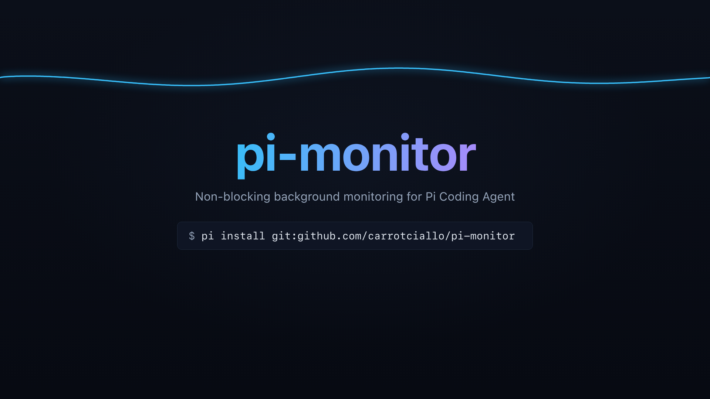

# pi-monitor

<p align="center">
  
</p>

<p align="center">
  <a href="https://nodejs.org"></a>
  <a href="https://github.com/carrotciallo/pi-monitor/actions"></a>
  <a href="https://github.com/carrotciallo/pi-monitor/blob/main/LICENSE"></a>
  <a href="https://github.com/carrotciallo/pi-monitor"></a>
</p>

<p align="center">
  <b>English</b> | <b>[简体中文](README.zh-CN.md)</b>
</p>

> **Nonblocking, bounded background monitoring for Pi Coding Agent.**  
> Start a trusted read-only query, receive a monitor ID immediately, and resume the session when a condition is stably matched, a query fails, or the deadline expires. Say goodbye to idle token-burning polling loops in your agent workflows.

---

## ⚡ Why pi-monitor?

When managing long-running background tasks (e.g. multi-step builds, long CI pipelines, server provisioning, database restores), standard AI Coding Agents fall into active polling traps:

| Dimension | Legacy Agent Polling ❌ | With pi-monitor ✅ |
| :--- | :--- | :--- |
| **Execution Model** | Burns turn cycles with repetitive `sleep` and status tools | Instantly yields control; nonblocking bounded background polling |
| **Token Consumption** | Repetitive status checks consume massive prompt context | Headless scheduler queries in background; **0 extra LLM tokens burned** |
| **Turn Lifecycle** | Blocks user interaction or triggers dead-loop safeguards | Agent continues independent tasks or ends turn cleanly awaiting wakeup |
| **Stability Validation** | Susceptible to transient flickers or single false positives | Dual debounce: `consecutiveMatches` and `stableForSeconds` |
| **Concurrency & Safety** | Risk of overlapping queries and ReDoS vulnerabilities | **Single in-flight lock**, RE2JS ReDoS immunity, and scoped call leases |

---

## Architecture Overview

**Pi-Web is supported, but not required.**  
The extension relies on native Pi host extension APIs rather than a web-only backend. Compatible terminal hosts display a compact live status widget; background queries and session resume work equally well in headless environments.

---

## Installation

```sh
pi install git:github.com/carrotciallo/pi-monitor
```

Run `/reload` in an existing session.  
*Requirements*: Node.js >= 22.19.0. The host must supply `ExtensionToolContext.executeTool`, `before_agent_start.systemPromptOptions.promptGuidelines`, and standard extension messaging APIs.

---

## Quick Start & Scenarios

### Tools and Commands

| Tool / Command | Type | Purpose |
| :--- | :--- | :--- |
| `monitor_start` | Agent Tool | Start bounded polling of a trusted read-only tool; returns `monitorId` immediately |
| `monitor_status` | Agent Tool | Inspect current-session monitor details, health metrics, and retained output |
| `monitor_cancel` | Agent Tool | Stop a specific monitor or all active monitors in the current session |
| `/monitor_status [id]` | User Command | CLI / Web command to view live monitor status |
| `/monitor_cancel [id\|all]` | User Command | CLI / Web command to terminate background monitors |

---

### Scenario 1: Waiting for a Build / CI Job Completion

The agent triggers an asynchronous job, starts monitoring, and yields immediately:

```json
{
  "tool": "job_status",
  "args": { "id": "build-release-1024" },
  "condition": { "field": "status", "equals": "completed" },
  "consecutiveMatches": 2,
  "description": "Wait for build release completion"
}
```

---

### Scenario 2: Service Drain Stability Hold

For state transitions that require prolonged stability (e.g. connection draining before shutdown):

```json
{
  "tool": "bash",
  "args": { "command": "job-status --json" },
  "condition": { "field": "state", "equals": "drained" },
  "intervalSeconds": 30,
  "timeoutSeconds": 21600,
  "consecutiveMatches": 3,
  "stableForSeconds": 120,
  "description": "Wait for drain to hold stable for two minutes"
}
```

> **Note**: For `bash` and `hypa_shell`, when execution succeeds (`exit_code: 0`) and the output is valid JSON, the output is automatically unwrapped for field evaluation. Only exact JSON is adapted—no partial or fuzzy parsing.

---

## Behavior & Robustness

When a task is pending and requires a later check, the agent calls `monitor_start` instead of executing a polling loop.

- **Defaults & Limits**:
  - Polling interval: 5s (range: 2–300s)
  - Timeout: 120s (range: 5–604,800s / up to 7 days)
  - Max retries: 3 on transient errors (range: 0–10)
  - Concurrency: Max 5 concurrent monitors per session.
  - **Single In-Flight Lock**: Queries for a given monitor never overlap.
- **Stability Engine**:
  - `consecutiveMatches` (1–1000, default 1): Requires N continuous observed matches.
  - `stableForSeconds` (0–604800, default 0): Requires condition to hold continuously for at least N seconds.
  - Any miss or query failure immediately resets stability counters to prevent premature completion.
- **Smart Deduplication**: Starting a monitor with the same tool, canonical-JSON arguments, condition, and polling config reuses the existing active monitor and sets `reused: true`.
- **Matching Engine**: Supports structured field checks (equality, numeric comparison, array inclusion), negation-aware text matching, RE2JS regular expressions, or SHA-256 hashes. RE2JS eliminates ReDoS risks.
- **UI & Resumption**:
  - Displays live status badge, task name, query count, elapsed time, health progress, and observed values.
  - On condition match, query failure, or timeout, a concise notification wakes the session. Raw response payloads stay in `monitor_status` to prevent context pollution.
- **Branch & Lifecycle Isolation**: Branch switches, session changes, reloads, or shutdowns transition active monitors to `interrupted` without firing turn-waking messages into improper sessions.

---

## Safety & Permissions

- **Default-Deny Read Policy**: Non-shell tools must pass a strict read-only policy.
- **Shell Query Constraints**: `bash` and `hypa_shell` accept nonempty commands. System guidelines instruct the agent to execute only idempotent read-only status checks. Commands inherit the host's existing permission boundaries.
- **Call Leases**: Scoped, one-use call leases allow seamless compatibility with external repeat guards and loop protection extensions.
- **Memory-Only & Redaction**: Execution state lives in memory only. Retained audit logs are capped at 10 items per session with automated redaction of sensitive arguments.

---

## Development & Testing

```sh
# Install development dependencies
npm ci --include=dev

# Type checking
npm run check

# Run full automated test suite
npm test

# Verify packaging integrity
npm pack --dry-run
```

CI runs on Node.js 22 and 24 with 83 automated test cases (76 passing, 7 environment-guarded integration tests safely skipped).

---

## Contributing & License

Contributions, issues, and PRs are welcome!  
See [CONTRIBUTING.md](CONTRIBUTING.md), [SECURITY.md](SECURITY.md), and [MIT License](LICENSE).
