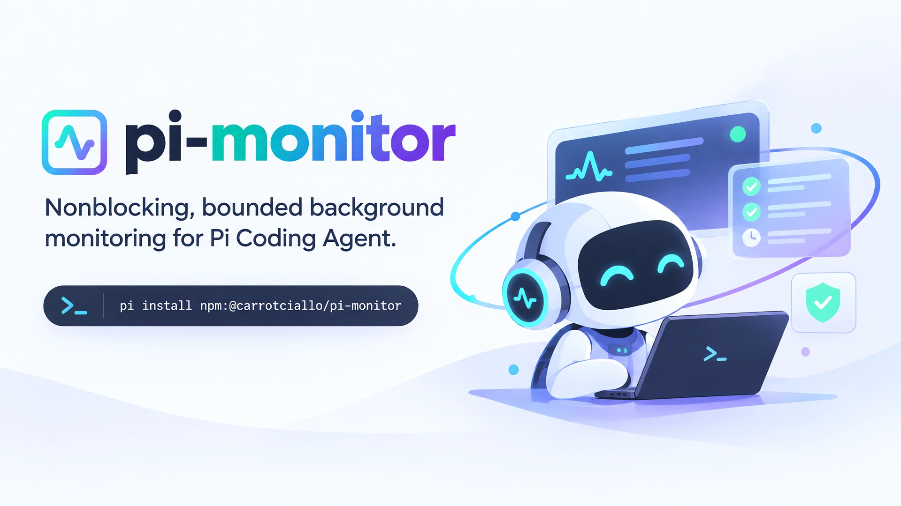

# pi-monitor

<p align="center">
  
</p>

<p align="center">
  <a href="https://nodejs.org"></a>
  <a href="https://github.com/carrotciallo/pi-monitor/blob/main/LICENSE"></a>
  <a href="https://github.com/carrotciallo/pi-monitor"></a>
</p>

<p align="center">
  <b>English</b> | <b><a href="README.zh-CN.md">简体中文</a></b>
</p>

> **Nonblocking, bounded background monitoring for Pi Coding Agent.**  
> Start a trusted read-only query and receive a monitor ID immediately. When the monitor ends, record its observation, confirm it entered the session, then request a separate model wake. Avoid token-burning polling loops without confusing query completion with notification delivery.

---

## ⚡ Why pi-monitor?

When managing long-running background tasks (e.g. multi-step builds, long CI pipelines, server provisioning, database restores), standard AI Coding Agents fall into active polling traps:

| Dimension | Legacy Agent Polling ❌ | With pi-monitor ✅ |
| :--- | :--- | :--- |
| **Execution Model** | Burns turn cycles with repetitive `sleep` and status tools | Instantly yields control; nonblocking bounded background polling |
| **Token Consumption** | Repetitive status checks consume massive prompt context | Sampling does not invoke the model; subsequent wake turns still consume tokens |
| **Turn Lifecycle** | Blocks user interaction or triggers dead-loop safeguards | Agent continues independent tasks or ends turn cleanly awaiting wakeup |
| **Stability Validation** | Susceptible to transient flickers or single false positives | Dual debounce: `consecutiveMatches` and `stableForSeconds` |
| **Concurrency & Safety** | Risk of overlapping queries and ReDoS vulnerabilities | **Single in-flight lock**, RE2JS ReDoS immunity, and scoped call leases |

---

## Architecture Overview

**Pi-Web is supported, but not required.**  
The extension relies on native Pi host extension APIs rather than a web-only backend. Compatible terminal hosts display a compact live status widget. Notification persistence and model wake are tracked separately in both UI and headless hosts; neither proves that a user has seen the observation.

---

## Installation

```sh
pi install npm:@carrotciallo/pi-monitor
```

Or install straight from the repository:

```sh
pi install git:github.com/carrotciallo/pi-monitor
```

Run `/reload` in an existing session after updating, or start a new session. Updating files does not hot-reload an already running extension. Reload interrupts active polling; it does not resume execution afterward.

**1.4.1 is available as a [GitHub release](https://github.com/carrotciallo/pi-monitor/releases/tag/v1.4.1).** GitHub releases and npm publication are separate; this release does not establish that npm has the same version. Use the repository installation for these changes and verify the installed package version.

*Requirements*: Node.js >= 22.19.0. The host must supply `ExtensionToolContext.executeTool`, `before_agent_start.systemPromptOptions.promptGuidelines`, idle/pending-message checks, branch reads, custom entries and standard extension messaging APIs. See [integration setup and rollback](integrations/README.md) for the optional, version-pinned ACP/MCP compatibility patches; those are not automatically applied by installing the base extension.

---

## Quick Start & Scenarios

### Tools and Commands

| Tool / Command | Type | Purpose |
| :--- | :--- | :--- |
| `monitor_start` | Agent Tool | Start bounded polling of a trusted read-only tool; returns `monitorId` immediately |
| `monitor_status` | Agent Tool | Inspect current-session monitor details, health metrics, and retained output |
| `monitor_cancel` | Agent Tool | Stop a specific monitor or all active monitors in the current session |
| `/monitor_status [id]` | User Command | CLI / Web command to view live monitor status |
| `/monitor_cancel [id\|all]` | User Command | CLI / Web command to terminate background monitors |
| `/monitor-delivery` | User Command | Inspect branch-local notification receipts and separate wake-request states |
| `/monitor-errors` | User Command | Inspect bounded, correlated diagnostics without raw query arguments |

---

### Scenario 1: Waiting for a Build / CI Job Completion

The agent triggers an asynchronous job, starts monitoring, and yields immediately:

```json
{
  "tool": "job_status",
  "args": { "id": "build-release-1024" },
  "condition": { "field": "status", "equals": "completed" },
  "consecutiveMatches": 2,
  "description": "Wait for build release completion"
}
```

---

### Scenario 2: Service Drain Stability Hold

For state transitions that require prolonged stability (e.g. connection draining before shutdown):

```json
{
  "tool": "bash",
  "args": { "command": "job-status --json" },
  "condition": { "field": "state", "equals": "drained" },
  "intervalSeconds": 30,
  "timeoutSeconds": 21600,
  "consecutiveMatches": 3,
  "stableForSeconds": 120,
  "description": "Wait for drain to hold stable for two minutes"
}
```

> **Note**: For `bash` and `hypa_shell`, when execution succeeds (`exit_code: 0`) and the output is valid JSON, the output is automatically unwrapped for field evaluation. Only exact JSON is adapted—no partial or fuzzy parsing.

---

## Behavior & Robustness

When a task is pending and requires a later check, the agent calls `monitor_start` instead of executing a polling loop.

- **Defaults & Limits**:
  - Polling interval: 5s (range: 2–300s)
  - Timeout: 120s (range: 5–604,800s / up to 7 days)
  - Max retries: 3 on transient errors (range: 0–10)
  - Concurrency: Max 5 concurrent monitors per session.
  - **Single In-Flight Lock**: Queries for a given monitor never overlap.
- **Stability Engine**:
  - `consecutiveMatches` (1–1000, default 1): Requires N continuous observed matches.
  - `stableForSeconds` (0–604800, default 0): Requires condition to hold continuously for at least N seconds.
  - Any miss or query failure immediately resets stability counters to prevent premature completion.
- **Smart Deduplication**: Starting a monitor with the same tool, canonical-JSON arguments, condition, `display` declaration, and polling config reuses the existing active monitor and sets `reused: true`.
- **Matching Engine**: Supports structured field checks (equality, numeric comparison, array inclusion), negation-aware text matching, RE2JS regular expressions, or SHA-256 hashes. RE2JS eliminates ReDoS risks.
- **UI & Resumption**:
  - Displays live status badge, task name, query count, elapsed time, health progress, and observed values.
  - **Progress display** (`display`): Declare up to 4 result fields to project into the live widget, so a polled script can report progress — download percentage, item counts, transfer speed — without the user asking for a status check. Each entry names a field path plus an optional `label`, `total`, or `totalField`:

    ```jsonc
    {
      "tool": "read",
      "args": { "path": "/tmp/progress.json" },
      "condition": { "field": "status", "equals": "done" },
      "display": [
        { "field": "downloaded", "label": "progress", "totalField": "totalBytes" },
        { "field": "speed", "label": "speed" }
      ]
    }
    ```

    renders as `progress=530/1000 · speed=1.2MB/s`. `totalField` reads a sibling field and wins over a fixed `total`. Values are bounded to 80 characters, sensitive field paths (containing `key`, `token`, `secret`, `password`, …) render as `[REDACTED]`, and composite values collapse to `[object]` or `[array: N]`. A failed or field-less sample clears the segment rather than showing a stale reading. Omitting `display` leaves the widget exactly as it was.
  - On condition match, terminal query failure, or timeout, a minimal outbox receipt is saved. Once the session is idle with no queued messages, a non-waking notification is appended and verified before requesting a separate model wake. Bounded response previews stay in `monitor_status`, not in notifications.
- **Branch & Lifecycle Isolation**: Branch switches, session changes, reloads, or shutdowns transition active monitors to `interrupted` without firing turn-waking messages into improper sessions.

---

## Notification Delivery in 1.4.1

`notified: true` now means that a matching notification entry was found in the active session branch, **not** merely that `sendMessage()` returned. Monitor completion, notification persistence and successful model execution are different outcomes.

| Delivery state | Meaning |
| :--- | :--- |
| `pending` | An unsent receipt is saved; waiting for a safe idle boundary |
| `submitted` | A submission was attempted; receipt verification is in progress |
| `persisted` | The matching notification entry exists in the active branch |
| `delivery_unknown` | Persistence could not be confirmed; no blind resend |
| `suppressed` | Cancellation/interruption deliberately sends no terminal notification; `notified` is false |

Wake state is separate: `not_requested`, `submitted`, `persisted`, or `unconfirmed`. A wake without a matching entry after 30 seconds becomes `unconfirmed` with a fixed diagnostic. Even a persisted wake marker does not prove a successful model response.

- Busy sessions have **no bounded delivery latency**. Pending state remains inspectable; the extension does not interrupt the user to force delivery.
- Recovery only retries definitely unsent `pending` receipts in the active branch. Ambiguous submissions and wake attempts are not replayed; old-branch work is not delivered into a new branch.
- Receipts contain IDs, tool name, terminal status and check count, not raw arguments, conditions, descriptions or errors. Old missing notifications without receipts are not reconstructed.
- Validation: 158 tests passed with integration fixtures enabled and zero skips. SDK 1.1.0 and 1.5.2 tests verified two rapid failures reaching actual session JSONL, including simulated asynchronous wake rejection and recovery deduplication. **Live model end-to-end wake has not been verified by these tests.**

## Safety & Permissions

- **Default-Deny Read Policy**: Non-shell tools need a known read-only builtin, a live `readOnlyHint: true` declaration, or an explicit trusted Allow rule. Unproven tools are rejected.
- **Live Annotations Only**: Cached names cannot prove runtime ownership, schema identity or freshness and never grant access. When an adapter drops live annotations, explicitly Allow only tools you have verified as read-only.
- **Non-Shell Hard Blocks**: Generic gateways (`mcp`, `mcpScript`), unverified MCP proxies, `destructiveHint: true`, and mutating tool names cannot be admitted by an Allow rule. A concrete MCP tool can pass the prefix check only with verified adapter ownership and schema identity; this does not bypass read-only checks. A proxy name alone never grants access to the tools behind it.
- **Shell Query Constraints**: `bash` and `hypa_shell` accept arbitrary nonempty commands, including tools with destructive metadata, but never bypass explicit Deny rules. System guidelines instruct the agent to execute only idempotent read-only status checks. Commands inherit the host's existing permission boundaries.
- **Call Leases**: Scoped leases support independent consumers so cooperating guards can verify the same monitor call without consuming each other's authority. Compatibility requires guard integration; unrelated guard plugins are not automatically exempted. See [integration contracts](integrations/README.md).
- **Retention & Redaction**: Runtime records and cached descriptors are capped at 10 per session. Durable session history is not capped: version-2 lifecycle entries store argument digests and fixed classifications, not raw arguments, conditions or results. Named sensitive fields are redacted in bounded status previews; arbitrary free text is not guaranteed safe. Existing version-1 history is not rewritten; see [SECURITY.md](SECURITY.md).

### Trusting a tool your host cannot vouch for

Many MCP servers describe their tools loosely, or not at all, so the default deny keeps them out of reach. Rather than weakening the default for every tool, you can vouch for specific tools in a Markdown file, which keeps the justification next to the rule:

```markdown
# pi-monitor trust

## Allow
- `mail_list_*` — read-only listings; the server omits annotations
- index_search

## Deny
- mail_get_emails_content
```

- **User level**: `~/.pi/agent/pi-monitor.md`, always read. Set `PI_MONITOR_TRUST_FILE` to keep the rules elsewhere.
- **Project level**: `PI-MONITOR.md` at the project root, read **only** when the project is trusted, so an untrusted repository cannot grant itself monitoring access.
- Patterns are globs: `*` matches any run of characters, `?` exactly one; matching is case-insensitive.
- Only `-` list items under an `Allow`/`Deny` heading are rules. Everything else is documentation and is ignored, so the file can explain itself.
- An explicit `Deny` beats every allow path, including shell tools and annotations. An explicit `Allow` rescues an unannotated tool. Neither can override a hard block above.

A commented starting point lives at [`docs/trust-example.md`](docs/trust-example.md); copy it to `~/.pi/agent/pi-monitor.md` and edit the two lists.

The legacy cache lookup is diagnostic only; neither `~/.pi/agent/mcp-cache.json` nor `PI_MONITOR_MCP_CACHE` grants monitoring permission.

---

## Development

```sh
# Install development dependencies
npm ci --include=dev

# Type checking
npm run check

# Tests (external integration cases require the fixtures described in integrations/README.md)
npm test

# Verify packaging integrity
npm pack --dry-run
```

---

## Contributing & License

Contributions, issues, and PRs are welcome!  
See [CONTRIBUTING.md](CONTRIBUTING.md), [SECURITY.md](SECURITY.md), and [MIT License](LICENSE).
