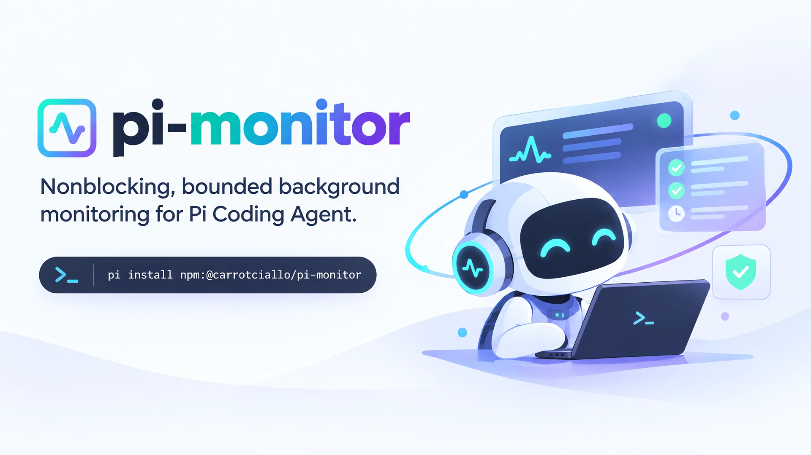

# pi-monitor

<p align="center">
  
</p>

<p align="center">
  <a href="https://nodejs.org"></a>
  <a href="https://github.com/carrotciallo/pi-monitor/blob/main/LICENSE"></a>
  <a href="https://github.com/carrotciallo/pi-monitor"></a>
</p>

<p align="center">
  <b><a href="README.md">English</a></b> | <b>简体中文</b>
</p>

> **Pi Coding Agent 的非阻塞、有界后台监控插件。**  
> 启动可信只读查询后立即返回监控 ID。监控结束时先记录观察结果，确认通知进入会话后，再单独请求模型唤醒。减少主动轮询的 Token 消耗，同时明确区分查询结束与通知投递成功。

---

## ⚡ 为什么需要 pi-monitor？

在长耗时任务（如构建打包、环境部署、后台批处理、集群健康检查）中，传统的 Coding Agent 通常陷入主动轮询的泥潭：

| 维度 | 传统 Agent 轮询方式 ❌ | 采用 pi-monitor 方式 ✅ |
| :--- | :--- | :--- |
| **执行模式** | 在主对话中反复调用 `sleep` 或重复执行状态查询 | 启动监控后立即释放控制权，非阻塞有界调度 |
| **Token 消耗** | 每次轮询都重复占用 LLM 上下文，极其昂贵且烧 Token | 采样不调用模型；后续唤醒回合仍会消耗 Token |
| **会话状态** | 阻塞当前交互回合，极易触发死循环熔断或超时崩溃 | Agent 可立即继续执行其他独立工作，或结束当前回合静待唤醒 |
| **稳定性校验** | 容易被偶发状态波动或单次假阳性结果欺骗 | 支持 `consecutiveMatches`（连续命中）与 `stableForSeconds`（稳定时长）双重防抖 |
| **并发与安全** | 多并发轮询容易冲突重叠，缺少防 ReDoS 等安全边界 | 严格单飞行锁 (In-flight Lock)、RE2JS 引擎防 ReDoS、调用租约 (Call Lease) 隔离 |

---

## 流程概览

**支持 Pi-Web，但不依赖 Pi-Web。**  
插件使用 Pi 宿主原生扩展 API，无 Web 专属后端依赖。在兼容的终端宿主中可显示紧凑状态面板。UI 与无 UI 宿主均分别跟踪通知入会话和模型唤醒；这两项都不代表用户已经看到观察结果。

---

## 安装

```sh
pi install npm:@carrotciallo/pi-monitor
```

也可直接从仓库安装：

```sh
pi install git:github.com/carrotciallo/pi-monitor
```

更新后，在已有会话中执行 `/reload`，或新建会话。更新磁盘文件不会热重载已经运行的扩展；重载会中断活动轮询，不会自动恢复执行。

**1.4.1 已通过 [GitHub Release](https://github.com/carrotciallo/pi-monitor/releases/tag/v1.4.1) 提供。** GitHub Release 与 npm 发布是独立的，本次发布不代表 npm 已有同版本。要使用这些修改，请从仓库安装并核对实际包版本。

*运行要求*：Node.js >= 22.19.0，宿主必须支持 `ExtensionToolContext.executeTool`、`before_agent_start.systemPromptOptions.promptGuidelines`、空闲/待处理消息检查、分支读取、自定义条目及标准扩展消息 API。可选的固定版本 ACP/MCP 兼容补丁见[集成安装与回滚说明](integrations/README.md)；安装基础扩展不会自动应用这些补丁。

---

## 快速上手与典型场景

### 工具与命令速览

| 工具 / 命令 | 类型 | 用途 |
| :--- | :--- | :--- |
| `monitor_start` | Agent 工具 | 对可信只读工具启动有界后台查询，立即返回 `monitorId` |
| `monitor_status` | Agent 工具 | 查看当前会话监控详情、健康指标及保留的结果记录 |
| `monitor_cancel` | Agent 工具 | 取消指定监控或当前会话全部活动监控 |
| `/monitor_status [id]` | 用户命令 | 终端 / Web 手动检查监控状态详情 |
| `/monitor_cancel [id\|all]` | 用户命令 | 终端 / Web 手动中止监控任务 |
| `/monitor-delivery` | 用户命令 | 查看当前分支的通知投递凭据与独立的唤醒状态 |
| `/monitor-errors` | 用户命令 | 查看有数量限制、可关联且不含原始查询参数的诊断 |

---

### 场景 1：等待长任务构建完成

Agent 提交异步作业后，启动监控并设定条件，立即结束当前回合等待唤醒：

```json
{
  "tool": "job_status",
  "args": { "id": "build-release-1024" },
  "condition": { "field": "status", "equals": "completed" },
  "consecutiveMatches": 2,
  "description": "Wait for build release completion"
}
```

---

### 场景 2：服务平滑排水 (Drain) 连续稳定检测

对于关键状态变更，需确保状态稳定保持一段时间（如平滑下线、节点排水），避免瞬时抖动：

```json
{
  "tool": "bash",
  "args": { "command": "job-status --json" },
  "condition": { "field": "state", "equals": "drained" },
  "intervalSeconds": 30,
  "timeoutSeconds": 21600,
  "consecutiveMatches": 3,
  "stableForSeconds": 120,
  "description": "Wait for drain to hold stable for two minutes"
}
```

> **注**：当 `bash` 或 `hypa_shell` 的执行结果为 JSON 时（且 `exit_code: 0`），插件会自动解包并进行结构化字段匹配。整段文本严格解析，杜绝截断或模糊提取。

---

## 核心行为与稳定性保障

任务仍未完成且需要稍后复查时，Agent 会主动使用 `monitor_start`，停止直接轮询。启动后继续执行独立工作，无独立工作则结束当前回合等待通知。

- **调度与并发**：默认查询间隔 5 秒、超时 120 秒、错误自动重试 3 次。每个会话最多 5 个并发监控；同一监控具备**单飞行锁 (Single In-flight Lock)**，绝不会堆叠重叠查询。
- **配置边界**：
  - 采样间隔：2–300 秒
  - 超时时限：5–604,800 秒（最长可达 7 天）
  - 错误重试：0–10 次
- **稳定性防抖 (Debounce)**：
  - `consecutiveMatches`（1–1000，默认 1）：要求连续命中指定次数。
  - `stableForSeconds`（0–604800，默认 0）：要求命中状态持续稳定保持指定秒数。
  - 只要出现一次未命中或查询错误，防抖进度立即重置，杜绝瞬态假报警。
- **智能去重 (Deduplication)**：同一会话内，若工具、规范化参数、判定条件、`display` 声明与轮询配置完全相同，`monitor_start` 自动复用正在运行的监控并标记 `reused: true`。
- **匹配引擎**：支持结构化字段比对（相等、包含、数值范围）、否定感知文本匹配、RE2JS 正则表达式或 SHA-256 校验。RE2JS 引擎在源头根除 ReDoS 正则回溯漏洞。
- **UI 与通知体验**：
  - UI 呈现状态徽标、任务摘要、查询计数、耗时、健康采样进度及相关字段值。已确认的终态短暂保留后回收；未解决的投递状态继续可见。
  - **进度显示（`display`）**：最多声明 4 个结果字段投射到实时 widget，被轮询的脚本因此无需用户追问即可上报进度——如下载百分比、条目计数、传输速率。每项指定字段路径，可选 `label`、`total` 或 `totalField`：

    ```jsonc
    {
      "tool": "read",
      "args": { "path": "/tmp/progress.json" },
      "condition": { "field": "status", "equals": "done" },
      "display": [
        { "field": "downloaded", "label": "progress", "totalField": "totalBytes" },
        { "field": "speed", "label": "speed" }
      ]
    }
    ```

    渲染为 `progress=530/1000 · speed=1.2MB/s`。`totalField` 读取同级字段，优先级高于固定的 `total`。取值上限 80 字符；敏感字段路径（含 `key`、`token`、`secret`、`password` 等）显示为 `[REDACTED]`；复合值塌缩为 `[object]` 或 `[array: N]`。查询失败或字段缺失时清空该片段，绝不残留陈旧读数。省略 `display` 时 widget 行为与原先完全一致。
  - 达成条件、超时或查询终止失败后，先保存最小化待投凭据。待会话空闲且无排队消息时，追加不唤醒模型的通知并核对会话条目，再单独请求模型唤醒。`monitor_status` 保留有大小限制的响应预览，通知不包含原始结果。
- **生命周期隔离**：分支切换、会话切换、重载或关闭时，监控自动标记为 `interrupted`（被中断）优雅停止，绝不跨分支/跨会话误唤醒。

---

## 1.4.1 的通知投递语义

`notified: true` 现在表示已在当前会话分支找到对应通知条目，**不再只是 `sendMessage()` 返回**。监控结束、通知进入会话与模型成功执行是不同结果。

| 投递状态 | 含义 |
| :--- | :--- |
| `pending` | 已保存尚未发送的凭据，等待安全空闲时机 |
| `submitted` | 已尝试提交，正在核对通知条目 |
| `persisted` | 当前分支存在对应通知条目 |
| `delivery_unknown` | 无法确认入会话，不盲目重发 |
| `suppressed` | 取消或中断按设计不发终态通知；`notified` 为 false |

唤醒状态独立记录为 `not_requested`、`submitted`、`persisted` 或 `unconfirmed`。唤醒请求 30 秒后仍无对应条目，会标记 `unconfirmed` 并写入固定分类诊断。即使唤醒标记已进入会话，也不证明模型响应成功。

- 持续忙碌的会话**没有有限投递时延保证**。待投状态保持可查，不强制打断用户以完成投递。
- 恢复时仅重投当前分支确定未发送的 `pending` 凭据。结果不明的提交和唤醒不自动重放，旧分支待投工作不会发送到新分支。
- 凭据包含 ID、工具名、终态和检查次数，不包含原始参数、条件、描述或错误。旧版丢失且没有凭据的通知不会自动补造。
- 验证：启用集成测试夹具后，158 项测试通过、零跳过。SDK 1.1.0 和 1.5.2 测试确认两条快速失败通知写入真实会话 JSONL，覆盖模拟的异步唤醒拒绝与恢复去重。**这些测试尚未验证真实模型端到端唤醒。**

## 安全策略与限制

- **Default-Deny 只读策略**：非 shell 工具须属于已知只读内置工具、有实时 `readOnlyHint: true` 声明，或得到受信任配置中的显式 Allow；无依据一律拒绝。
- **仅使用实时注解**：缓存名称不能证明运行时工具来源、schema 一致性与时效，不能授予权限。适配器未转发实时注解时，仅为已核实只读的工具显式配置 Allow。
- **非 Shell 工具的硬拦**：通用网关（`mcp`、`mcpScript`）、未经核验的 MCP 代理、`destructiveHint: true` 及变异类工具名不能凭 Allow 放行。具体 MCP 工具仅在适配器归属与 schema 身份经过验证后才可通过前缀检查，仍须满足只读策略；仅凭代理名称不能获得其背后工具的权限。
- **Shell 查询约束**：`bash` 和 `hypa_shell` 接受任意非空命令，包括带破坏性元数据的工具，但不能绕过显式 Deny。提示词强约束 Agent 仅执行状态查询，非沙箱命令过滤器；命令原样交由宿主执行并继承宿主权限链路。
- **租约隔离 (Call Lease)**：限定作用域的租约支持独立消费者，协作守卫可以核验同一次监控调用而不抢占彼此的授权。兼容性需要守卫接入，未接入的插件不会自动豁免；见[集成契约](integrations/README.md)。
- **保留范围与脱敏**：每个会话最多保留 10 条运行时记录和 10 条缓存描述符，持久化会话历史不受此数量限制。新版 v2 生命周期条目只保存参数摘要与固定分类，不保存原始参数、条件或结果。状态预览有大小限制并按字段名脱敏，但任意自由文本无法保证安全；既有 v1 历史不会自动改写，见 [SECURITY.md](SECURITY.md)。

### 为宿主无法背书的工具授权

许多 MCP server 对工具的描述很粗糙甚至完全缺失，默认拒绝会把它们挡在门外。与其为所有工具放宽默认策略，不如在 Markdown 文件里为你确认过的工具单独背书——理由和规则写在一起：

```markdown
# pi-monitor 信任清单

## Allow
- `mail_list_*` — 只读列表类查询；该 server 未提供注解
- index_search

## Deny
- mail_get_emails_content
```

- **用户级**：`~/.pi/agent/pi-monitor.md`，始终读取。可用环境变量 `PI_MONITOR_TRUST_FILE` 改到其他位置。
- **项目级**：项目根目录的 `PI-MONITOR.md`，**仅当项目受信任时**才读取，避免不可信仓库自我提权。
- 模式为 glob：`*` 匹配任意字符，`?` 匹配单个字符，大小写不敏感。
- 只有 `Allow`/`Deny` 标题下的 `-` 列表项才算规则，其余内容均为文档并被忽略，因此文件可以自我说明。
- 显式 `Deny` 优先于所有放行路径，包括 Shell 和注解；显式 `Allow` 可放行无注解工具。两者都无法越过硬拦。

带注释的起手模板见 [`docs/trust-example.md`](docs/trust-example.md)：复制到 `~/.pi/agent/pi-monitor.md` 后改两个列表即可。

旧缓存查询仅供诊断；`~/.pi/agent/mcp-cache.json` 和 `PI_MONITOR_MCP_CACHE` 均不能授予监控权限。

---

## 本地开发

```sh
# 安装依赖
npm ci --include=dev

# 静态类型检查
npm run check

# 测试（外部集成用例需要 integrations/README.md 中说明的测试夹具）
npm test

# 验证发布包打包规范
npm pack --dry-run
```

---

## 许可证与贡献

欢迎提交 Issue 与 Pull Request！  
请查阅 [贡献指南 (CONTRIBUTING.md)](CONTRIBUTING.md)、[安全报告规范 (SECURITY.md)](SECURITY.md) 与 [MIT 开源许可证 (LICENSE)](LICENSE)。
