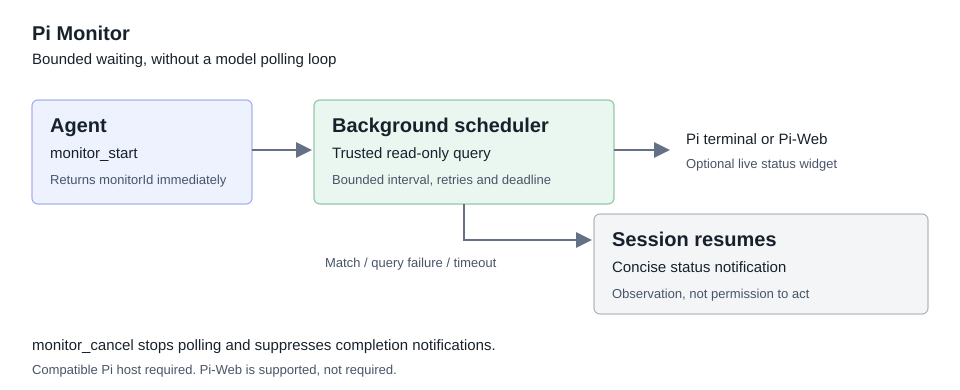

# pi-monitor

<p align="center">
  <a href="https://nodejs.org"></a>
  <a href="https://github.com/carrotciallo/pi-monitor/actions"></a>
  <a href="https://github.com/carrotciallo/pi-monitor/blob/main/LICENSE"></a>
  <a href="https://github.com/carrotciallo/pi-monitor"></a>
</p>

<p align="center">
  <b>[English](README.md)</b> | <b>简体中文</b>
</p>

> **Pi Coding Agent 的非阻塞、有界后台监控插件。**  
> 启动可信只读查询后立即返回监控 ID；当目标条件稳定命中、查询失败或超时后，自动发送轻量通知唤醒会话。彻底终结 Agent 主动死循环轮询带来的 Token 浪费与上下文膨胀。

---

## ⚡ 为什么需要 pi-monitor？

在长耗时任务（如构建打包、环境部署、后台批处理、集群健康检查）中，传统的 Coding Agent 通常陷入主动轮询的泥潭：

| 维度 | 传统 Agent 轮询方式 ❌ | 采用 pi-monitor 方式 ✅ |
| :--- | :--- | :--- |
| **执行模式** | 在主对话中反复调用 `sleep` 或重复执行状态查询 | 启动监控后立即释放控制权，非阻塞有界调度 |
| **Token 消耗** | 每次轮询都重复占用 LLM 上下文，极其昂贵且烧 Token | 后台无模型参与定时采样，**0 额外模型 Token 损耗** |
| **会话状态** | 阻塞当前交互回合，极易触发死循环熔断或超时崩溃 | Agent 可立即继续执行其他独立工作，或结束当前回合静待唤醒 |
| **稳定性校验** | 容易被偶发状态波动或单次假阳性结果欺骗 | 支持 `consecutiveMatches`（连续命中）与 `stableForSeconds`（稳定时长）双重防抖 |
| **并发与安全** | 多并发轮询容易冲突重叠，缺少防 ReDoS 等安全边界 | 严格单飞行锁 (In-flight Lock)、RE2JS 引擎防 ReDoS、调用租约 (Call Lease) 隔离 |

---

## 流程概览



> 🎬 **宣传视频与演示**：可在浏览器直接打开 [可交互视频演示](docs/promo-video/index.html)，或播放 [1080p 宣传短片](docs/promo-video/pi-monitor-promo-subtitled.mp4)（含中英双语分镜与字幕）。

**支持 Pi-Web，但不依赖 Pi-Web。**  
插件使用 Pi 宿主原生扩展 API，无 Web 专属后端依赖。在兼容的终端宿主中可实时显示紧凑字符状态面板；无 UI 宿主亦能完全在后台可靠执行查询与唤醒。

---

## 安装

```sh
pi install git:github.com/carrotciallo/pi-monitor
```

在已有会话中执行 `/reload` 即可加载。  
*运行要求*：Node.js >= 22.19.0，宿主必须支持 `ExtensionToolContext.executeTool`、`before_agent_start.systemPromptOptions.promptGuidelines` 和标准扩展消息 API。

---

## 快速上手与典型场景

### 工具与命令速览

| 工具 / 命令 | 类型 | 用途 |
| :--- | :--- | :--- |
| `monitor_start` | Agent 工具 | 对可信只读工具启动有界后台查询，立即返回 `monitorId` |
| `monitor_status` | Agent 工具 | 查看当前会话监控详情、健康指标及保留的结果记录 |
| `monitor_cancel` | Agent 工具 | 取消指定监控或当前会话全部活动监控 |
| `/monitor_status [id]` | 用户命令 | 终端 / Web 手动检查监控状态详情 |
| `/monitor_cancel [id\|all]` | 用户命令 | 终端 / Web 手动中止监控任务 |

---

### 场景 1：等待长任务构建完成

Agent 提交异步作业后，启动监控并设定条件，立即结束当前回合等待唤醒：

```json
{
  "tool": "job_status",
  "args": { "id": "build-release-1024" },
  "condition": { "field": "status", "equals": "completed" },
  "consecutiveMatches": 2,
  "description": "Wait for build release completion"
}
```

---

### 场景 2：服务平滑排水 (Drain) 连续稳定检测

对于关键状态变更，需确保状态稳定保持一段时间（如平滑下线、节点排水），避免瞬时抖动：

```json
{
  "tool": "bash",
  "args": { "command": "job-status --json" },
  "condition": { "field": "state", "equals": "drained" },
  "intervalSeconds": 30,
  "timeoutSeconds": 21600,
  "consecutiveMatches": 3,
  "stableForSeconds": 120,
  "description": "Wait for drain to hold stable for two minutes"
}
```

> **注**：当 `bash` 或 `hypa_shell` 的执行结果为 JSON 时（且 `exit_code: 0`），插件会自动解包并进行结构化字段匹配。整段文本严格解析，杜绝截断或模糊提取。

---

## 核心行为与稳定性保障

任务仍未完成且需要稍后复查时，Agent 会主动使用 `monitor_start`，停止直接轮询。启动后继续执行独立工作，无独立工作则结束当前回合等待通知。

- **调度与并发**：默认查询间隔 5 秒、超时 120 秒、错误自动重试 3 次。每个会话最多 5 个并发监控；同一监控具备**单飞行锁 (Single In-flight Lock)**，绝不会堆叠重叠查询。
- **配置边界**：
  - 采样间隔：2–300 秒
  - 超时时限：5–604,800 秒（最长可达 7 天）
  - 错误重试：0–10 次
- **稳定性防抖 (Debounce)**：
  - `consecutiveMatches`（1–1000，默认 1）：要求连续命中指定次数。
  - `stableForSeconds`（0–604800，默认 0）：要求命中状态持续稳定保持指定秒数。
  - 只要出现一次未命中或查询错误，防抖进度立即重置，杜绝瞬态假报警。
- **智能去重 (Deduplication)**：同一会话内，若工具、规范化参数、判定条件与轮询配置完全相同，`monitor_start` 自动复用正在运行的监控并标记 `reused: true`。
- **匹配引擎**：支持结构化字段比对（相等、包含、数值范围）、否定感知文本匹配、RE2JS 正则表达式或 SHA-256 校验。RE2JS 引擎在源头根除 ReDoS 正则回溯漏洞。
- **UI 与通知体验**：
  - UI 呈现状态徽标、任务摘要、查询计数、耗时、健康采样进度及相关字段值。终态短暂保留后自动回收。
  - 达成条件、超时或致命错误后，通过精炼通知唤醒会话回合。原始完整响应与排查细节保存在 `monitor_status` 中，不挤占通知上下文。
- **生命周期隔离**：分支切换、会话切换、重载或关闭时，监控自动标记为 `interrupted`（被中断）优雅停止，绝不跨分支/跨会话误唤醒。

---

## 安全策略与限制

- **只读策略**：非 shell 工具默认执行严格拒绝的只读策略，仅允许选定内置读取工具及带只读注解的查询。
- **Shell 查询约束**：`bash` 和 `hypa_shell` 接受非空只读命令。提示词强约束 Agent 仅执行状态查询，非沙箱命令过滤器；命令原样交由宿主执行并继承宿主权限链路。
- **租约隔离 (Call Lease)**：提供限定作用域的单次调用租约，无缝兼容外部防重放/防死循环守卫扩展。
- **内存安全与脱敏**：运行时监控状态驻留内存，历史审计记录严格限制在每个会话最多 10 条，敏感参数脱敏与结果截断双重防护。

---

## 本地开发与测试

```sh
# 安装依赖
npm ci --include=dev

# 静态类型检查
npm run check

# 执行完整自动化测试套件
npm test

# 验证发布包打包规范
npm pack --dry-run
```

CI 测试环境基于 Node.js 22 和 Node.js 24。运行测试套件时 83 项用例完备覆盖（76 项常规用例通过，7 项需外部 Guard 插件的环境用例安全跳过）。

---

## 许可证与贡献

欢迎提交 Issue 与 Pull Request！  
请查阅 [贡献指南 (CONTRIBUTING.md)](CONTRIBUTING.md)、[安全报告规范 (SECURITY.md)](SECURITY.md) 与 [MIT 开源许可证 (LICENSE)](LICENSE)。
